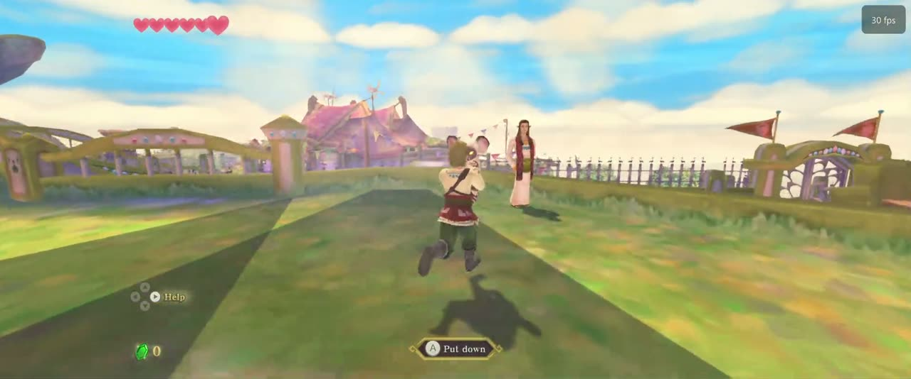
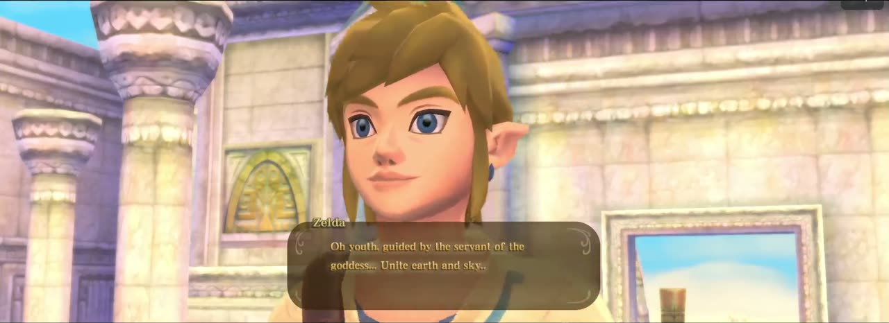

# SkywardRecomp

Work-in-progress static recompilation of *The Legend of Zelda: Skyward Sword HD* (Switch, v1.0.0 and v1.0.1) into a native
Windows app with a Vulkan renderer. Derived from [LAS Recomp](https://github.com/peiikai/LASRecomp).

<a href="https://recomplauncher.com"><picture><source media="(prefers-color-scheme: dark)" srcset="https://recomplauncher.com/assets/press/launcher/badge-light.svg"></picture></a>

> **Unofficial fan project, not affiliated with or endorsed by Nintendo.** "The Legend of Zelda" and "Skyward Sword"
> are trademarks of Nintendo. This repository contains **no** game code, assets, fonts, keys or game files.
> You must supply your own legally obtained copy of the game; the build generates C code locally from your files,
> and that output (`generated/`, `extracted/`, `input/`) is git-ignored and must never be shared.

## How to play

You need your own *Skyward Sword HD* **1.0.0 base game** (`01002DA013484000`, `v0`, no update): its `.nsp` with your
Switch's `prod.keys`, or a folder with its `exefs` and `romfs`.

- **RecompLauncher:** install SkywardRecomp there and pick your copy (and `prod.keys` for an `.nsp`). It builds the
  game code once and keeps it up to date; its setup is in [`recomplauncher.json`](recomplauncher.json).
- **By hand:** download the Windows zip from [Releases](https://github.com/Ramasanjaya22/SkywardRecomp/releases),
  unzip it somewhere you can write to, run `skywardrecomp.exe` and choose your copy (and `prod.keys` for an `.nsp`)
  on the start screen.
- **Scripts:** `skywardrecomp --prepare --game=<folder or .nsp> --keys=<prod.keys>` sets it up without a window
  (`progress <0..1> <step>` lines on stdout), then `skywardrecomp --play` starts the game.

## Demo

[](https://youtu.be/3KJOw7pbSQ0)

▶ [Watch the 2-minute demo on YouTube](https://youtu.be/3KJOw7pbSQ0)

## Screenshots

Running natively on Windows (Vulkan, 21:9 ultrawide).

| | |
|---|---|
|  |  |
|  |  |

## Progress

**Overall: ~80%** (estimate as of 2026-11-19)

```
[████████████████░░░░] 80%
```

| Area | Progress | State |
|---|---|---|
| Loader, kernel/HLE services, boot to title screen | `██████████` 100% | done |
| Threading (condvar lost-wakeup fix), 30 fps pacing | `██████████` 100% | done |
| Audio (audren voices) | `██████████` 100% | done |
| App builds and tests pass on Windows, Linux and macOS (CI) | `██████████` 100% | done |
| Vulkan renderer: textures, depth/stencil, dual-source blend (eyes) | `██████████` 100% | done, eyes confirmed in game 2026-11-18 |
| Character lighting | `██████████` 100% | confirmed in game 2026-11-18 |
| Shadow rendering | `██████████` 100% | confirmed in game 2026-11-18, no shadow bug |
| Save-file names (`□□` glyphs) | `██████████` 100% | fixed (swkbd UTF-16), confirmed in game 2026-11-19 |
| LA-specific HLE modules and address tables replaced for SS | partial | 2 verified SS addresses per patch table (`runtime/game_addresses/patches_v1_0_{0,1}.h`); runtime tables still all `0x0`; the former 30% counted LA leftovers, not SS addresses |
| Ultrawide, resolution options | `██████████` 100% | 21:9 textures, shadows and characters confirmed in game 2026-11-19 |
| 60 fps | implemented, not end-to-end verified | frame-rate setting Auto/30/60/90/120/Unlocked wired; 90 s `--play` baseline 59-60 fps; 90/120/Unlocked experimental |
| Long-session stability / full playthrough | `███░░░░░░░` 30% | 150 s+ runs OK, no full playthrough |

Where shown, the percentage is a rough milestone estimate, not a measured figure; the two rows above are qualitative because the available evidence supplies no defensible percentage for them after 2026-11-22. Evidence: `TASKS.md:28` (old SS-table 30% was LA leftovers), `TASKS.md:165` (90 s 59-60 fps baseline), commits `316eec43`, `068ceed6`, `9d4fbbfd`, `61de4f7c` (frame-rate setting/pacing), and the current address tables (2 verified SS addresses in each patch table, runtime tables all `0x0`).

## Setup

Start here: [docs/SETUP.md](docs/SETUP.md) (requirements, game files, prod.keys, troubleshooting).

See [Saving and transferring data](docs/saves.md) for backups and emulator save transfers.

## Keyboard + mouse

Controls tab → **Keyboard + Mouse** applies the preset and turns on Mouse camera, Mouse combat and Free camera look (the mouse camera needs Free camera). The sliders are on the same page.

| Input | Action |
|---|---|
| W A S D | move |
| Mouse | camera |
| Left click | sword slash, in the direction you move the mouse |
| Middle click | thrust |
| Right click | target + shield |
| Mouse 4 (held) | aim the item, then left click uses it |
| Shift / Space / E / F | sprint / jump / interact / item action |
| Q | free camera toggle |
| R | item wheel |
| Tab / M / Enter | inventory / map / pause |
| Esc | overlay menu |

The key layout is not yet checked in a full game session and may change.

## Building (Windows)

See [docs/BUILD-windows.md](docs/BUILD-windows.md) (MSYS2 UCRT64, clang, Vulkan 1.3 GPU, AVX2/FMA CPU).

## Texture packs (Vulkan, experimental)

Put your own DDS files in `textures/` under the data root (next to `extracted/` and `save/`). Filenames follow
Kenji-NX: `<prefix>_<32 hex XXH3-128>_<w>x<h>x<d>.dds`, for example `tex2d_99aa06d3014798d86001c324468d497f_1024x1024x1.dds`.
Only BC1, BC3, BC5 and BC7 files that match the game texture's format and top-level dimensions are used; a missing
file, a wrong format or a short mip chain is logged once and the game texture is kept. Kenji-NX's level/slice form
(`..._0x0.dds`) is accepted too. 8-bit RGB/RGBA PNG packs are also read: their image is sampled to the game
texture's size (and to each mip), for ASTC textures. No texture packs ship with the app.

## Legal

- Code in this repository: MIT, see [LICENSE](LICENSE) and [THIRD_PARTY_NOTICES.md](THIRD_PARTY_NOTICES.md).
- The license does not cover Nintendo's game or trademarks.
- Do not open issues or PRs containing game files, keys, extracted data or instructions for obtaining them.

## Credits

SkywardRecomp stands on the work of these projects. Thank you.

- **[LAS Recomp](https://github.com/peiikai/LASRecomp)** by Peiikai: the base of this project (recompiler pipeline,
  runtime, HLE services, Vulkan backend). MIT.
- **nxnative** and **MacNativeGames**: the runtime and target layer that LAS Recomp builds on (see
  `ss-reference/COPIES-mac-port.md` for exact sources). MIT.
- **Ryujinx**: Maxwell shader translator sources (`third_party/ryujinx`). MIT.
- **[Kenji-NX](https://git.ryujinx.app/projects/Kenji-NX)**: texture-pack filename scheme and XXH3-128 identity (`runtime/nvn/xxh3_128.c`). MIT.
- **[Dear ImGui](https://github.com/ocornut/imgui)** by Omar Cornut. MIT.
- **[SMAA](https://github.com/iryoku/smaa)** by Jorge Jimenez et al.
- **[RenderDoc](https://renderdoc.org)** by Baldur Karlsson: used for GPU capture debugging.
- **[libnx / switchbrew](https://github.com/switchbrew/libnx)**: Switch OS structures and service references.
- **BIZ UDPGothic, Baloo 2, DejaVu** fonts: see `third_party/fonts/`.

Not affiliated with any of the above or with Nintendo.

## Contributing

See [CONTRIBUTING.md](CONTRIBUTING.md).